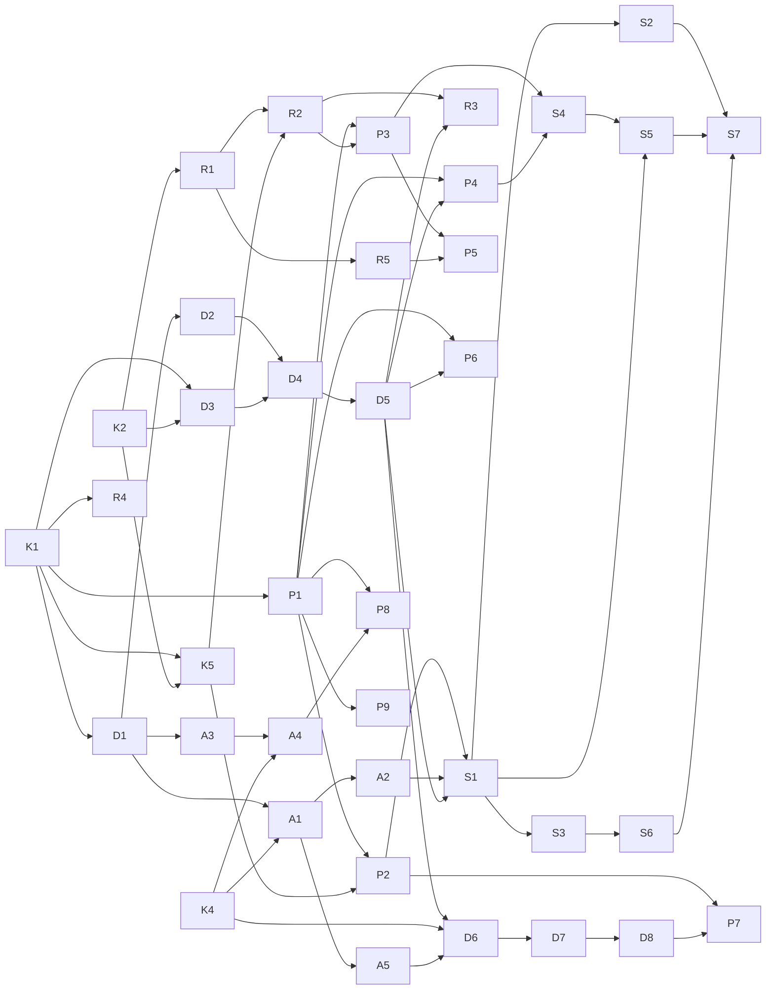

# TASKS.md: Cool Flames task board

Snapshot of the team task board for NASA Space Apps 2026 ("Flame in Freefall"). Project context is in `CLAUDE.md`; the data contract is in `SCHEMA.md`.

Snapshot taken: Sun 15 Nov 2026, 00:45 Europe/Berlin. The live board (Claude Sheets) is the source of truth; if this file and the live board disagree, ask the human.

Last updated by Claude Code: **Sun 15 Nov 2026, ~03:30 (Ramneek session 3)** — see Change log.

## Working agreement for Claude Code (READ FIRST, both sessions)

This repo is built by two people, each driving their own Claude Code, committing to `main` and pulling each other's work. To stay coherent across sessions:

1. **At the start of a session:** read `CLAUDE.md` (now describes the project as built, with a status section 16), `SCHEMA.md`, then this file's **Change log** below. The Change log is the dated record of every decision and why; keep `CLAUDE.md` section 16 in step with it.
2. **Confirm the task ID** with the human and stay inside that owner's folders (CLAUDE.md §5: Malay owns `pipeline/`, `core/`, `data/clean/`, `data/manual/`, README; Ramneek owns `ai/`, `data/ai/`, `app/`, deploy).
3. **When you finish a task:** set its Status to `Done` here, tick its checkbox, update the **Progress** count and the **Ready now** list, and append a dated bullet to the **Change log** describing what changed — *especially any decision that deviates from `CLAUDE.md` or the schema*.
4. **Keep the app working at every commit** (the team may deploy at any moment) and commit in small steps with `area: what changed` messages.
5. If a decision changes the data contract, update `SCHEMA.md` and flag it here; both owners must agree.

> In short: whoever works next should be able to read this file top-to-bottom and know exactly what is done, what changed, and what is ready — without having to re-derive it. Keep it current.

## How to use this file

- Status values: `To do`, `In progress`, `Done`, `Cut`. A task marked `Cut` counts as finished for its dependents.
- A task is **ready** when every task in its *Depends on* list is `Done` or `Cut`.
- When you finish a task: tick its checkbox, set its status to `Done`, then re-check the *Unlocks* list to see what became ready. Move those to the Ready now section.
- Before starting a task, confirm with the human which task ID you are on and stay inside that owner's folders (see `CLAUDE.md` section 5).
- Never mark a task `Done` until its *Done when* condition is actually true (run the check, do not assume).
- Edit this file with small diffs. Keep task IDs stable; never renumber.

## Progress

**30 of 39 done**, plus **K4 and A5 cut**. Left: K3 (confirm deadline), S1 (deploy), S2 (test public link), S4/S6 (drafts in `docs/`, need a timing run and the final links), S5 (record video), S7 (submit). `data/clean/tests.csv`: **1,858 rows from 19 tables** (1,009 with O₂ and pressure); all 24 investigations have summaries; Ask index built. Nothing from these sessions is pushed yet.

## Change log (approach changes & decisions — newest first)

### Sun 15 Nov 2026, ~04:40 — Ramneek session 6: CLAUDE.md brought up to date (Claude Code)

- `CLAUDE.md` rewritten from "original brief, kept verbatim" to **current state**:
  - stack, layout and data contract as built;
  - verified sources;
  - real counts (about 2,000 runs, 1,858 standardized, 1,009 plotted);
  - app pages and navigation;
  - conventions, including restarting Streamlit after `core/` or JS changes;
  - task statuses (30 done, 2 cut, 7 open);
  - a new **section 16** listing what remains, in order.
- Original intent (goals, domain background, scoring formula, demo story) is kept.

- **Mechanism:** Streamlit Custom Components v2 (`st.components.v2.component`), registered in `app/components/interactive.py`, with the JS in `app/static/js/`. p5.js 1.11.1 and three.js 0.170.0 load from cdn.jsdelivr.net; each component shows a static fallback offline and honours `prefers-reduced-motion`. Gotcha: p5 hides new canvases and un-hides them via `document`, which can't see inside the component's shadow root, so each sketch sets `visibility: visible` itself.
- **Habitat designer (Scenario page, two-way):** drag a point on the O₂-vs-pressure plane (real runs as dots, ppO₂ curves, presets as stars). The live readout counts runs nearby. On release, the value is sent to Python (`setStateValue('point')`), which stores `st.session_state["custom_habitat"]` and switches the habitat to `"custom"`, so ranking, warnings, sidebar and Gap map all use it. Other controls: "Where is it?" (Orbit / Moon / Mars → gravity), exact-value inputs, Back to ISS.
- **Core change (additive):** `core.scenarios.resolve_habitat()`; `rank()` and `get_warnings()` accept a preset key or a habitat dict. Each HABITAT now has `gravity_g` (ISS and suit 0; Moon base and exploration habitat 1/6 g).
- **Flame Lab (new page, Explore):** an illustrative p5.js particle flame with sliders for gravity, O₂, airflow and fuel, plus six "Try this" presets.
  - Rules cite Olson 2004 (buoyant flow ~50·√g cm/s; gentle-breeze effect; starving without flow), Link et al. 2018 (limiting O₂ 1 point lower in μg), and Nayagam et al. 2014 (droplet cool flame at 14–21 % O₂, not at 25 %).
  - Droplet flames are not starved in still air (FLEX burned in a quiescent chamber).
  - Below the canvas: the matching μg PSI studies with their tested O₂ range, "no data yet" for Moon/Mars, and Earth-vs-space findings for 1 g.
- **Animated hero (Home, three.js):** a starfield plus a flame cloud that follows the selected habitat (a sphere in μg, a teardrop and rising embers under gravity, brighter with more O₂). Uses solid ember colours in light mode. Pauses off-screen.
- **Verified** in headless Chrome over the DevTools protocol:
  - dark and light themes, 1440 px and 390 px;
  - designer drag round-trip: ISS → 9 psi / 40 % O₂ updates the ranking header, sidebar and Gap map;
  - droplet cycle: hot → cool flame → evaporating;
  - reduced motion: hero frames identical;
  - no JS errors.
  - 80 tests pass.
- **Restart the dev server after pulling:** the JS files are read at startup.

- **Theme:** new `.streamlit/config.toml`, "mission control" look. Dark-first navy background with a flame-orange accent, plus a matching light theme (follows the OS setting). Fonts are Space Grotesk headings, Inter body and JetBrains Mono code, loaded from Google Fonts (they fall back to the system font offline). `toolbarMode = "minimal"`.
- **Navigation (deviates from CLAUDE.md §5 layout):** `app/Home.py` is now the **router** (`st.navigation`). Pages moved from `app/pages/N_*.py` to `app/views/*.py` (`home`, `overview`, `scenario`, `gap_map`, `compare`, `ask`, `earth_benefits`), grouped as Explore / Tools / About with icons and clean URLs (`/scenario`, `/gap-map`, `/overview`…). "Overview" is now labelled **Investigations**. The deploy main file is unchanged: `app/Home.py`.
- **Shell:** logo (`app/static/logo.svg`, `icon.svg`), and a habitat picker plus atmosphere card (O₂, psi, ppO₂, partial-gravity note) rendered once by the router for every page. Views read it with `current_habitat()`.
- **Components (`app/components/__init__.py`):** `page_header`, `stat_row` (bordered metrics), restyled `investigation_card` (condition chips; "table not standardized" instead of "0 standardized"), `result_card` (rank, score bar, component chips), warning cards with icons, styled footer.
- **Pages:**
  - Home: hero band, stat tiles, "Start here" cards, habitat insight and oxygen history.
  - Scenario: scenario pills (`short`/`icon` added to `core/scenarios.py`), phase tabs with icons, weights in a sidebar panel, 2-column result cards.
  - Investigations: Earth-vs-space shown as flagged cards.
  - Ask: example pills (ask once per click).
  - Charts use the theme surfaces.
- **Tests:** new `tests/test_app_pages.py` loads every page through the router and checks the Moon smoke demo path. 76 pass. Checked in real headless-Chrome screenshots: dark and light at 1440 px, and phone width at 390 px.
- **After pulling:** restart `streamlit run app/Home.py`. A running server keeps the old modules and theme.

**A1/A2 — Done (no external batch run needed).** Summaries, `fuels`, `fuel_types` and key findings for all 24 investigations were written by Claude from each record's own text and publication titles (`data/ai/ai_fields.json`), then merged with `python ai/tag_summarize.py --import data/ai/ai_fields.json`. Validated: 3 lines each, 1–4 findings, no "safe/approved/will not burn" wording. **Someone on the team should still read every summary once** (plan requirement).

**R4 — Done.** `data/manual/earth_vs_space.csv`, 8 rows, every number checked against the source text: Link et al. 2018 Sci Rep (PMMA 17% µg vs 18% 1 g; faster µg spread below 19% O₂), Olson 2004 NASA/TM-2004-213114 (cellulose 16.5% vs 14% at 5–20 cm/s; flames survive in a fraction of a cm/s; upwind spread), Nayagam et al. 2014 NTRS 20140006750 (n-decane cool flames 14–21% O₂), and the PSI-99 table (silicone burned in 1 g but not µg; SIBAL burned in both). **No FLEX CO₂-limit row:** the Dietrich 2014 numbers could not be verified from an accessible source, so they were left out. **Schema change (additive):** new `flag` column (short verdict shown in the app); `SCHEMA.md` updated. Shown on the Overview page.

**D7 follow-up fix.** The Saffire-II mapping counted 4 footnote rows and 2 flow-visualisation rows as runs (15 → **9**). Fixed with `require`. `n_runs` in investigations.json now uses the standardized count when a table is mapped (raw rows otherwise); PSI-142's table lists paper figures, so its n_runs is 0. Total runs: **1,982**; standardized: **1,858**. Ranking sanity check unchanged (SAME-R 0.648, SAME 0.628).

**A3/A4/P8 — Done.** `ai/build_index.py` → `data/ai/index/` (44 chunks, all-MiniLM-L6-v2, FAISS IndexFlatIP, `embeddings.npy` fallback). `ai/qa.py`: hybrid retrieval (70% embedding cosine + 30% keyword score; the small model alone missed "cool flames" questions), coverage check on raw cosine (off-topic questions are declined), Gemini answer with DOI citations if `GEMINI_API_KEY`/`GEMINI_MODEL` are set, otherwise the source passages. Falls back FAISS → NumPy → keyword-only. `app/pages/5_Ask.py` reads keys from Streamlit secrets; an import failure only disables this page. `tests/test_qa.py` (4 tests).

**Deploy prep (S1).** `requirements.txt` pinned (Python 3.12): streamlit 1.67.0, pandas 3.1.1, numpy 2.5.4, plotly 7.1.0, requests 2.34.2, python-dotenv 1.2.4, google-genai 3.3.0, sentence-transformers 6.3.0, faiss-cpu 1.16.0, torch 2.15.0 (**CPU-only wheel on Linux** via the PyTorch CPU index and a platform marker). `pytest` moved to `requirements-dev.txt`. A fresh venv installs it cleanly and every page loads (AppTest). `.streamlit/secrets.toml` is git-ignored.
- **Deploy settings:** share.streamlit.io → Create app → repo `malay24/Cool-Flames`, branch `main`, main file `app/Home.py`, Advanced settings → Python 3.12, secrets optional (`GEMINI_API_KEY`, `GEMINI_MODEL`).
- **If the Cloud install fails** (e.g. the torch index line): fallback per CLAUDE.md §4 is Hugging Face Spaces, or remove the three Ask-only lines; the Ask page then uses keyword search.

**S3 — Done.** README rewritten: pages, run steps, rebuild commands, data rules, ranking, all 24 DOIs, extra sources, AI-use note, licence.
**S4/S6 — drafted.** `docs/DEMO_SCRIPT.md` (6 steps, under 2 min, real numbers) and `docs/SUBMISSION.md` (form text with all DOIs and AI use; links left as placeholders).

**Tests:** 68 pass.

### Sun 15 Nov 2026, ~03:00 — Ramneek session 2 (Claude Code)

**Ownership:** Ramneek took over Malay's R1, R2, R3, R5, D6, D7, D8, P7 and P9 (agreed in chat) so the core pages could ship before the first deploy. R4 (earth_vs_space.csv) is still open: every row needs a cited paper.

**R1 — Done.** `core/scenarios.py`: `HABITATS` (iss, moon_brief, exploration, suit; with `ppo2_psi` and `partial_gravity` = True for moon_brief and exploration), `SCENARIOS` (6, §8.1), `PHASE_AREA`, `PHASE_LABELS`, `HISTORY`. `core/loaders.py` now holds the shared pure loaders (fake-data fallback, ranges from ranges.csv); `app/components/data.py` only wraps them in `st.cache_data`.

**D6 — Done (15 more tables, all `mapping_confidence: hand`).** tests.csv: 527 → **1,864 rows, 19 tables**; plottable (O₂ and pressure): 273 → **1,009** (FLEX 273, CFI-G 333, Flame Design 316, CFI 87).
- New mapping key **`require`** (rows with a blank required cell are skipped: E-FIELD continuation lines, Saffire-I flow-visualisation rows). Documented in `_FORMAT.md`.
- **Summary tables** (ACME BRE, CLD, E-FIELD, SLICE, FLEX-2, and s-Flame pressure) hold *lists* of conditions per day/fuel; only fuel, run_id and constants are mapped. A list-valued O₂/pressure cell (`21; 26.5; 40`, `~30% and ~21%`) is now blanked and flagged by `build_tests.py`, never collapsed to one number.
- Flame Design Normal uses `pinit (atm)` with `XO2 (init)` (pmean is blank on 20 rows). Rows with O₂ `RAMP` stay blank.
- **Skipped:** PSI-26 BASS (Malay's decision, run log only), PSI-47 DAFT (dust sampling, no combustion), PSI-142 (index of figures, not runs).
- SPICE has no O₂/pressure column → blank (strict policy). 8 SPICE rows with **negative airflow** (sensor offset) are blanked and flagged, like non-positive pressure; zero airflow is kept.
- 72 plotted runs have ppO₂ > 16 psi (CFI-G and Flame Design at up to 85% O₂ and ~3.3 bar). These are real conditions: kept and flagged, plotted.

**D7 — Done.** `python -m pipeline.spot_check` prints 20 sampled rows (round-robin across tables, seed 7) next to their raw cells. **Errors found and fixed:** Saffire-II spread `"Note 4"` was parsed as **4 mm/s**; Flame Design O₂ `"LOW O2"` was parsed as **200%**; s-Flame `"~30% and ~21% O2"` collapsed to 30. `parse_number` now ignores note references and chemical formulas; list values are blanked. Regression tests in `tests/test_build_tests.py`. Re-check with seed 11: all 20 rows match.

**D8 — Done.** `python -m pipeline.build_ranges` → `data/clean/ranges.csv` (n_standardized_runs, n_with_o2_and_pressure, min/max of O₂, pressure, airflow, sample size). `ai/tag_summarize.py` merges it into investigations.json (`*_range`, `sample_size_range`, `n_standardized_runs`); `n_runs` stays the raw-table count.

**R2/R3 — Done.** `core/ranking.py` implements §8.2 exactly (default weights 0.35/0.30/0.20/0.15; weights are divided by their sum so scores stay in [0,1]). Investigations with no test rows get fuel_realism 0. **Sanity check passes:** moon_brief + electrical_overheat, smoke → SAME-R 0.648, SAME 0.628, then Flame Design 0.556. `tests/test_ranking.py` (7 tests).

**R5 — Done.** `core/warnings.py`: blind spot, hidden hazard, no data yet (partial-gravity habitats), Earth tests not conservative (solid-fuel scenarios), outside tested range (nearest run of the top 3 relevant studies). Sources from CLAUDE.md §14. `tests/test_warnings.py` (also checks no "safe"/"approved" wording).

**P3/P5 — Done.** Scenario Explorer: scenario picker, phase tabs, 4 weight sliders + reset, stacked score-breakdown chart, cards with template explanation, component values, DOI, "conditions not reported" badge, warning cards per phase. By default only studies with area_match > 0 are ranked (toggle shows all).

**P4/P6 — Done.** Gap map: x = pressure, y = O₂, colour + marker shape by area, habitat stars with labels, iso-ppO₂ curves at 2.8/3.1/4.3 psi, "N of M runs plotted" caption explaining the pressure policy, "runs near this habitat" metric, table view, CSV download.

**P7/P9 — Done.** Compare: 2–4 investigations side by side (conditions, fuels, what varied, outcomes, main metric) plus similarity notes. Earth benefits: 3 items quoting only the PSI records' research-impacts text with DOIs; water mist and firefighter gear are **not** claimed (not in PSI).

**Tests:** 64 pass (was 25). All pages load with real data and with the fake fallback (AppTest).

**Demo script note (S4):** say "about 2,000 test runs, 1,864 standardized, 1,009 with O₂ and pressure". Near the Moon atmosphere: 64 runs; near the ISS: 341.

### Sun 15 Nov 2026 — Ramneek session (Claude Code)

**K4 — Cut (no LLM offer).** The Space Apps Global Offers include no Gemini offer: Google and Azure give general cloud credit only (card + billing + model deployment), not worth it now. New AI plan:
- **Batch AI work (tags, summaries, column mappings) is done externally** from the `data/raw/` upload, no key needed. Output is merged by `ai/tag_summarize.py --import`.
- **Ask page only** (stretch) uses a free Google AI Studio key (no card): `GEMINI_API_KEY` + `GEMINI_MODEL` in `.env` (and Streamlit secrets). `.env.example` now uses these names instead of `LLM_*` (deviates from CLAUDE.md §5).
- **A5 — Cut:** column mappings for D6 come from the same external batch work. D6 therefore no longer waits on K4/A5; mapping files must follow `pipeline/mappings/_FORMAT.md`.

**A1 — In progress (prompt, schema and batch export ready).**
- `ai/tag_summarize.py` builds `data/ai/investigations.json` (24 entries). **Facts come from `data/raw/`, never an LLM:** psi_id, name (acronym, else title), doi, hardware, platform, n_publications, publications, area (CLAUDE.md §3 table), test_scale (Saffire = large, modelling = ground, else orbital), n_runs.
- **`fuel_types` = fuel PHASES** (solid/liquid/gas) per the signed contract and §8.2 ranking, from a hand map of CLAUDE.md §3 (modelling studies take the phase of the data they model; DAFT = `[]`, dust not fuel). **Additive field `fuels`** = material names (display only, from AI). Also additive: `title`, `start_date`, `end_date`, `publications`, `ai_source`. No contract column changed.
- `n_runs` = non-empty rows of the raw tables (**2,009 total**, not ~2,900: several tables pad with blank rows, e.g. CFI-G Inverse has 1,015 lines but ~150 runs). → **S4/demo script: say "about 2,000 test runs"**.
- Ranges stay `null` in the JSON (D8 / contract). The app fills them at load time from `tests.csv` (`app/components/data.py`), so cards show real ranges today.
- `--export-batch` writes `data/ai/batch_input.jsonl` (24 prompts) for the external batch run; expected output format is in the script docstring (`data/ai/ai_fields.json`). `--llm` keeps an optional Gemini path.

**P1 — Done.** `app/components/` (`setup_page`, sidebar habitat picker persisted in `st.session_state["habitat"]`, disclaimer + footer, DOI links, cards, `warning_card`) and `app/components/data.py` (cached loaders, fake-data fallback with demo badge). Habitat presets use `core.scenarios.HABITATS` when it exists, else the CLAUDE.md §2 table. Each page adds `app/` to `sys.path` so it also runs standalone. Venv: Python 3.12 (3.11 not installed here); all 25 tests pass.
- **→ Malay / R1:** please expose `HABITATS = {key: {"label", "o2_pct", "pressure_psi", ...}}` with keys `iss`, `moon_brief`, `exploration`, `suit`; the app picks it up automatically.

**P2 — Done.** Overview: 3-column card grid from `investigations.json`, filters by area and fuel phase, text search, DOI link on every card, "AI summary pending" until the batch output is merged. Verified with AppTest on real and fake data (24 and 3 cards, no exceptions).

### Sun 15 Nov 2026 — Malay session (Claude Code)

**Infra**
- Created a Python venv at `.venv/` and installed `requests` + `pytest` for the pipeline. **`requirements.txt` is not yet version-pinned** — pin it before the first deploy (S1).

**D1 — fetch (Done)**
- The experiment tables are **not** at the record's `remote_url` field (that 404s). The working download route is the GEODE/OSDR studies endpoint, now baked into `fetch_psi.py`:
  `https://psi.nasa.gov/geode-py/ws/studies/{accession}/download?source=datamanager&file={file_name}`
- `fetch_psi.py` now downloads 24 records → `data/raw/*.json` **and** 22 experiment tables → `data/raw/tables/*.csv`. Idempotent (`--force` to refetch). 4 investigations are text-only with no table (PSI-60, PSI-62, PSI-115, PSI-117). ~2,870 test rows total across the 22 tables.

**D2 — inventory (Done)**
- Added `pipeline/inventory.py`, which (re)generates `data/raw/columns.md` (per-table columns + sample values).
- Column quirks to handle downstream: a UTF-8 BOM on the first header of several files, trailing spaces in headers, typos (`Samle Thickness`), units embedded in *values* (`20 cm/s`, `80 W`), and fuzzy/range values (`~ 21.5`, `22.1 to 22.0`).

**K2 — schema (Done)**
- `SCHEMA.md` signed by the human. No column changes from CLAUDE.md §6.

**K5 — fake data (Done)**
- `data/fake/tests.csv` (10 rows) + `data/fake/investigations.json` (3 entries: prevention/suppression/detection). Covers every enum, keeps real blanks (not zero-filled), ppo2 consistent; investigations use obviously-fake placeholder DOIs (`10.0000/demo-*`) so no demo entry is mistaken for a real citation. Unblocks R2 (ranking) and P2 (Overview) — both can be built before real data lands.

**D5 — build_tests.py (Done)**
- `python -m pipeline.build_tests` applies the 4 mappings → `data/clean/tests.csv` (**527 rows**: FLEX 274, BASS-II 129, SAME-R 109, Saffire-II 15). Consumes the `_FORMAT.md` rules (BOM strip, `~`/range→midpoint, unit conversion via `units.py`, `outcome_from`/`diluent_from`). **Run it as a module** (`python -m pipeline.build_tests`), not `python pipeline/build_tests.py`, or the `pipeline` import fails.
- Added `tests/test_schema.py` (validates both fake and clean `tests.csv`: columns, enums, ppo2 consistency, blanks). Full suite: **25 pass**.
- Decision: a non-positive pressure is treated as **not reported (blank)**, not 0 — 0 mmHg is unphysical (one FLEX row had `0`), unlike 0 airflow which is a real condition. Row kept, excluded from gap map, flagged.
- **Gap-map reality:** only **273 of 527 rows have both O2 and pressure** (all FLEX). BASS-II/Saffire/SAME-R carry no pressure (strict policy). The other 7 pressure-bearing tables come via D6. → Ramneek/P4: expect a sparse gap map until D6 lands.

**D4 — core-table mappings (Done) — key decisions**
- **Dropped BASS (PSI-26)** from the core tables: its experiment table is only a run log (fuel + IDs, **no conditions or metrics**). BASS-II (PSI-25) represents the BASS family instead. So the core set is **4 tables (FLEX, BASS-II, Saffire-II, SAME-R), not 5**. (Deviates from CLAUDE.md §7; the other 17 tables still come via D6.)
- **Pressure policy = STRICT, leave blank (affects the gap map).** Only **8 of 22 tables have a pressure column**. The other 14 — including BASS-II, all Saffire, SAME/SAME-R, SPICE, SLICE and the ACME experiments — ran at cabin pressure that was never tabulated. Per CLAUDE.md §11 (no fabrication) we **leave `pressure_psi` blank** rather than assume 14.7 psi. Consequence: those runs are **excluded from the gap map (P4)** but kept in `tests.csv`.
  - **→ Ramneek / P4:** design the gap map to show "N of M runs plotted" and note that pressure-less runs are omitted. Don't expect BASS-II/Saffire/SAME-R to appear on it.
- **Saffire O2** fuzzy values (`~ 21.5`, `22.1 to 22.0`) are parsed as the **range midpoint**, `~` stripped.
- **Mapping file format extended** beyond CLAUDE.md §7: added optional `outcome_from` and `diluent_from` blocks and `unit` hints (`fraction`, `pct`, `cm`, `cms`, pressure units). Documented in **`pipeline/mappings/_FORMAT.md`** — D5 (`build_tests.py`) and D6 must honour it.

**New/changed files this session:** `CLAUDE.md`, `TASKS.md` (now in repo), `pipeline/fetch_psi.py`, `pipeline/inventory.py`, `pipeline/units.py`, `tests/test_units.py` (23 pass), `pipeline/mappings/_FORMAT.md`, `pipeline/mappings/PSI-69_FLEX.json`, `PSI-25_BASS-II.json`, `PSI-99_SAFFIRE-2.json`, `PSI-101_SAME-R.json`, `data/raw/` (records + tables + `columns.md`).

**Notes for Ramneek's workstream (AI + app):**
- The data contract is signed — build the app against `data/fake/` until D5 lands `data/clean/tests.csv`.
- `investigations.json` ranges are computed from `tests.csv` by the pipeline (D8), **not** by the LLM.
- **A3 (Q&A index) is ready now** (depends only on D1) and can be built offline. **A1 is still blocked on K4** (API key).

## Milestones

| Time (Europe/Berlin) | Milestone |
|---|---|
| Sat 22:30 | Schema agreed (K2), fake data pushed (K5) |
| Sun 01:30 | Night check-in, then sleep by 02:00 |
| Sun 09:00 | Morning sync, plan the day |
| Sun 12:30 | Core features freeze, first deploy (S1) |
| Sun 15:30 | Feature freeze; only polish, demo and write-up after this |
| Sun 18:00 | Submission review |
| Sun 19:00 | Target submission (official deadline reportedly 23:59 local; confirm in K3) |

## Critical path

K1 -> D1 -> D2 -> D4 -> D5 -> (P4 gap map, R3 ranking check, S1 deploy) -> S4 demo script -> S5 video -> S7 submit.

**Current position:** K1, D1, D2, D3, D4, D5 done; `data/clean/tests.csv` exists (527 rows, 4 core tables). Next critical-path moves: **R1→R2** (ranking, so P3 unblocks) and **D6** (the other 17 tables, which also enriches the gap map). D6 needs K4 + A5 (Ramneek) first.

Cut order if behind: P9 Earth benefits, then P8 Ask, then P7 Compare.

## Ready now

- **S1** First deploy (Ramneek): requirements pinned; settings below in the Change log (session 3).
- **K3** Confirm deadline and team registration on the Space Apps site (Ramneek, 5 min).
- **S4** Time the demo script in `docs/DEMO_SCRIPT.md` on the deployed app (Both).
- **S6** Fill the form from `docs/SUBMISSION.md` once the app and video links exist (Ramneek).
- After S1: **S2** (Malay), **S5** (Both), then **S7**.

## Summary table

| ID | Task | Owner | Status | Depends on | Unlocks | Est (min) | Slot |
|---|---|---|---|---|---|---|---|
| K1 | Create GitHub repo with folder layout, add Ramneek | Malay | Done | - | K5, D1, D3, R4, P1 | 10 | Kickoff |
| K2 | Agree data schema, write SCHEMA.md | Both | Done | - | K5, D3, R1 | 15 | Kickoff |
| K3 | Confirm deadline and team registration | Ramneek | To do | - | - | 5 | Kickoff |
| K4 | Claim Gemini or Azure offer, API key in .env | Ramneek | Cut | - | D6, A1, A4 | 10 | Kickoff |
| K5 | Commit fake tests.csv (10 rows) and investigations.json (3) | Malay | Done | K1, K2 | R2, P2 | 10 | Kickoff |
| D1 | Run fetch_psi.py, commit data/raw/ | Malay | Done | K1 | D2, A1, A3 | 15 | Sat night |
| D2 | Inventory column names and units per table | Malay | Done | D1 | D4 | 20 | Sat night |
| D3 | units.py: psi, % O2, ppO2 conversions + tests | Malay | Done | K1, K2 | D4 | 30 | Sat night |
| D4 | Hand-map core tables (FLEX, BASS-II, Saffire-II, SAME-R; BASS dropped) | Malay | Done | D2, D3 | D5 | 90 | Sat night |
| D5 | build_tests.py: merge into data/clean/tests.csv | Malay | Done | D4 | D6, R3, P4, P6, S1 | 30 | Sat night |
| D6 | LLM proposes mappings for other 17 tables, review each | Malay | Done | D5, K4, A5 | D7 | 120 | Sun morning |
| D7 | Spot-check 20 random rows against raw CSVs | Malay | Done | D6 | D8 | 30 | Sun morning |
| D8 | Per-investigation ranges and run counts | Malay | Done | D7 | P7 | 20 | Sun morning |
| R1 | scenarios.py: 4 habitat presets, 6 scenarios with phases | Malay | Done | K2 | R2, R5 | 30 | Sat night |
| R2 | ranking.py: 4 score parts, weights as args | Malay | Done | R1, K5 | R3, P3 | 60 | Sat night |
| R3 | Sanity check: Moon Base + electrical overheat ranks SAME/SAME-R top | Malay | Done | R2, D5 | - | 20 | Sun morning |
| R4 | earth_vs_space.csv: 5 to 10 hand rows with sources | Malay | Done | K1 | - | 40 | Sun morning |
| R5 | Warning card rules (no data yet, hidden hazard, blind spot) | Malay | Done | R1 | P5 | 20 | Sun morning |
| A1 | Prompt + JSON schema for tags and summaries, test on 3 | Ramneek | Done | D1, K4 | A2, A5 | 30 | Sat night |
| A2 | Run on all 24, save investigations.json, read each | Ramneek | Done | A1 | S1 | 45 | Sat night |
| A3 | Q&A index: chunks, embeddings, FAISS | Ramneek | Done | D1 | A4 | 45 | Sun midday |
| A4 | Q&A function with DOI citations + keyword fallback | Ramneek | Done | A3, K4 | P8 | 45 | Sun midday |
| A5 | Help with column-mapping prompt for D6 | Ramneek | Cut | A1 | D6 | 20 | Sun morning |
| P1 | App skeleton: pages, sidebar habitat picker, disclaimer | Ramneek | Done | K1 | P2, P3, P4, P6, P8, P9 | 30 | Sat night |
| P2 | Overview page: cards, filters, DOI links | Ramneek | Done | P1, K5 | P7, S1 | 60 | Sat night |
| P3 | Scenario Explorer: pickers, phase tabs, ranked list, sliders | Ramneek | Done | P1, R2 | P5, S4 | 120 | Sun morning |
| P4 | Gap map: O2 vs psi scatter, habitats, ppO2 lines | Ramneek | Done | P1, D5 | S4 | 90 | Sun morning |
| P5 | Warning cards in Scenario Explorer | Ramneek | Done | P3, R5 | - | 30 | Sun midday |
| P6 | CSV download button | Ramneek | Done | P1, D5 | - | 10 | Sun midday |
| P7 | Compare page (stretch) | Malay | Done | P2, D8 | - | 60 | Sun afternoon |
| P8 | Ask page (stretch) | Ramneek | Done | P1, A4 | - | 45 | Sun afternoon |
| P9 | Earth benefits panel (stretch) | Malay | Done | P1 | - | 20 | Sun afternoon |
| S1 | First deploy to Streamlit Community Cloud | Ramneek | To do | P2, A2, D5 | S2, S3, S5 | 20 | Sun 12:30 |
| S2 | Test public link in private window and on phone | Malay | To do | S1 | S7 | 10 | Sun afternoon |
| S3 | README: run steps, data DOIs, AI-use note, disclaimer | Malay | Done | S1 | S6 | 40 | Sun 15:30 |
| S4 | Final demo script | Both | In progress | P3, P4 | S5 | 20 | Sun 15:30 |
| S5 | Record demo video | Both | To do | S4, S1 | S7 | 45 | Sun 15:30 |
| S6 | Project summary on form, all DOIs, AI use declared | Ramneek | In progress | S3 | S7 | 30 | Sun 18:00 |
| S7 | Final check and submit | Both | To do | S2, S5, S6 | - | 15 | Sun 18:00 |

## Tasks by workstream

### Kickoff

- [x] **K1: Create GitHub repo with folder layout, add Ramneek**
  - Owner: Malay | Status: Done | Estimate: 10 min | Slot: Kickoff
  - Depends on: nothing
  - Unlocks: K5, D1, D3, R4, P1
  - Done when: Both can push to main
- [x] **K2: Agree data schema, write SCHEMA.md**
  - Owner: Both | Status: Done | Estimate: 15 min | Slot: Kickoff
  - Depends on: nothing
  - Unlocks: K5, D3, R1
  - Done when: Both have signed off the columns
  - Result: SCHEMA.md written and signed; mirrors CLAUDE.md §6 (no column changes).
- [ ] **K3: Confirm deadline and team registration**
  - Owner: Ramneek | Status: To do | Estimate: 5 min | Slot: Kickoff
  - Depends on: nothing
  - Unlocks: nothing
  - Done when: Deadline written in the plan doc
- [x] **K4: Claim Gemini or Azure offer, API key in .env**
  - Owner: Ramneek | Status: Cut | Estimate: 10 min | Slot: Kickoff
  - Depends on: nothing
  - Unlocks: D6, A1, A4
  - Done when: Test call returns JSON
  - Result: Cut — no Gemini offer exists; batch AI done externally, Ask uses a free AI Studio key (see Change log).
- [x] **K5: Commit fake tests.csv (10 rows) and investigations.json (3)**
  - Owner: Malay | Status: Done | Estimate: 10 min | Slot: Kickoff
  - Depends on: K1, K2
  - Unlocks: R2, P2
  - Done when: Files in data/fake/ match schema
  - Result: data/fake/tests.csv (10 rows, all enums + blanks) and data/fake/investigations.json (3 areas) validated against the schema. Placeholder DOIs (10.0000/demo-*).

### Data pipeline (Malay)

- [x] **D1: Run fetch_psi.py, commit data/raw/**
  - Owner: Malay | Status: Done | Estimate: 15 min | Slot: Sat night
  - Depends on: K1
  - Unlocks: D2, A1, A3
  - Done when: 24 records and 22 tables in repo
  - Result: 24 records + 22 tables in data/raw/ (+ tables/). Tables fetched via GEODE studies endpoint, not remote_url — see Change log.
- [x] **D2: Inventory column names and units per table**
  - Owner: Malay | Status: Done | Estimate: 20 min | Slot: Sat night
  - Depends on: D1
  - Unlocks: D4
  - Done when: data/raw/columns.md written
  - Result: data/raw/columns.md generated by pipeline/inventory.py.
- [x] **D3: units.py: psi, % O2, ppO2 conversions + tests**
  - Owner: Malay | Status: Done | Estimate: 30 min | Slot: Sat night
  - Depends on: K1, K2
  - Unlocks: D4
  - Done when: 5 known values pass
  - Result: pipeline/units.py + tests/test_units.py — 23 cases pass (all unit types, real FLEX mmHg, 4 habitat ppO2 anchors).
- [x] **D4: Hand-map core tables (FLEX, BASS-II, Saffire-II, SAME-R)**
  - Owner: Malay | Status: Done | Estimate: 90 min | Slot: Sat night
  - Depends on: D2, D3
  - Unlocks: D5
  - Done when: Mappings saved in pipeline/mappings/
  - Result: 4 mappings in pipeline/mappings/ (+ _FORMAT.md). BASS (PSI-26) dropped as it has no condition/metric columns; pressure left blank globally. See Change log for all decisions.
- [x] **D5: build_tests.py: merge into data/clean/tests.csv**
  - Owner: Malay | Status: Done | Estimate: 30 min | Slot: Sat night
  - Depends on: D4
  - Unlocks: D6, R3, P4, P6, S1
  - Done when: tests.csv loads with all schema columns
  - Result: 527 rows from 4 core tables; tests/test_schema.py added (25 pass total). Run via `python -m pipeline.build_tests`. See Change log for the non-positive-pressure decision and gap-map sparsity note.
- [x] **D6: LLM proposes mappings for other 17 tables, review each**
  - Owner: Malay | Status: Done | Estimate: 120 min | Slot: Sun morning
  - Depends on: D5, K4, A5
  - Unlocks: D7
  - Done when: Every table has mapping_confidence set
- [x] **D7: Spot-check 20 random rows against raw CSVs**
  - Owner: Malay | Status: Done | Estimate: 30 min | Slot: Sun morning
  - Depends on: D6
  - Unlocks: D8
  - Done when: Errors fixed or noted
- [x] **D8: Per-investigation ranges and run counts**
  - Owner: Malay | Status: Done | Estimate: 20 min | Slot: Sun morning
  - Depends on: D7
  - Unlocks: P7
  - Done when: data/clean/ranges.csv written

### Ranking and scenarios (Malay)

- [x] **R1: scenarios.py: 4 habitat presets, 6 scenarios with phases**
  - Owner: Malay | Status: Done | Estimate: 30 min | Slot: Sat night
  - Depends on: K2
  - Unlocks: R2, R5
  - Done when: Presets importable by the app
- [x] **R2: ranking.py: 4 score parts, weights as args**
  - Owner: Malay | Status: Done | Estimate: 60 min | Slot: Sat night
  - Depends on: R1, K5
  - Unlocks: R3, P3
  - Done when: Returns ranked list on fake data
- [x] **R3: Sanity check: Moon Base + electrical overheat ranks SAME/SAME-R top**
  - Owner: Malay | Status: Done | Estimate: 20 min | Slot: Sun morning
  - Depends on: R2, D5
  - Unlocks: nothing
  - Done when: Ranking looks right on real data
- [x] **R4: earth_vs_space.csv: 5 to 10 hand rows with sources**
  - Owner: Malay | Status: Done | Estimate: 40 min | Slot: Sun morning
  - Depends on: K1
  - Unlocks: nothing
  - Done when: Each row cites a paper
- [x] **R5: Warning card rules (no data yet, hidden hazard, blind spot)**
  - Owner: Malay | Status: Done | Estimate: 20 min | Slot: Sun morning
  - Depends on: R1
  - Unlocks: P5
  - Done when: Function returns cards per scenario

### AI layer (Ramneek)

- [x] **A1: Prompt + JSON schema for tags and summaries, test on 3**
  - Owner: Ramneek | Status: Done | Estimate: 30 min | Slot: Sat night
  - Depends on: D1, K4
  - Unlocks: A2, A5
  - Done when: 3 outputs look right
- [x] **A2: Run on all 24, save investigations.json, read each**
  - Owner: Ramneek | Status: Done | Estimate: 45 min | Slot: Sat night
  - Depends on: A1
  - Unlocks: S1
  - Done when: data/ai/investigations.json committed
- [x] **A3: Q&A index: chunks, embeddings, FAISS**
  - Owner: Ramneek | Status: Done | Estimate: 45 min | Slot: Sun midday
  - Depends on: D1
  - Unlocks: A4
  - Done when: Index saved in data/ai/index/
- [x] **A4: Q&A function with DOI citations + keyword fallback**
  - Owner: Ramneek | Status: Done | Estimate: 45 min | Slot: Sun midday
  - Depends on: A3, K4
  - Unlocks: P8
  - Done when: Answers cite DOIs; works offline
- [x] **A5: Help with column-mapping prompt for D6**
  - Owner: Ramneek | Status: Cut | Estimate: 20 min | Slot: Sun morning
  - Depends on: A1
  - Unlocks: D6
  - Done when: Prompt returns structured JSON
  - Note: the mapping format D6 expects is documented in `pipeline/mappings/_FORMAT.md` (includes `outcome_from`/`diluent_from`/`unit` hints). Target that format.

### Streamlit app (mostly Ramneek)

- [x] **P1: App skeleton: pages, sidebar habitat picker, disclaimer**
  - Owner: Ramneek | Status: Done | Estimate: 30 min | Slot: Sat night
  - Depends on: K1
  - Unlocks: P2, P3, P4, P6, P8, P9
  - Done when: streamlit run shows all pages
  - Note: skeleton pages already stubbed in `app/` (Home.py + pages/1..6). Flesh out P1 from there.
- [x] **P2: Overview page: cards, filters, DOI links**
  - Owner: Ramneek | Status: Done | Estimate: 60 min | Slot: Sat night
  - Depends on: P1, K5
  - Unlocks: P7, S1
  - Done when: Cards render from investigations.json
- [x] **P3: Scenario Explorer: pickers, phase tabs, ranked list, sliders**
  - Owner: Ramneek | Status: Done | Estimate: 120 min | Slot: Sun morning
  - Depends on: P1, R2
  - Unlocks: P5, S4
  - Done when: Sliders change ranking live
- [x] **P4: Gap map: O2 vs psi scatter, habitats, ppO2 lines**
  - Owner: Ramneek | Status: Done | Estimate: 90 min | Slot: Sun morning
  - Depends on: P1, D5
  - Unlocks: S4
  - Done when: Every test run with O2 AND pressure plotted
  - Note: pressure is sparse — only 8 of 22 tables measure it (see Change log). Show "N of M runs plotted" and note that pressure-less runs (BASS-II, Saffire, SAME-R, etc.) are omitted.
- [x] **P5: Warning cards in Scenario Explorer**
  - Owner: Ramneek | Status: Done | Estimate: 30 min | Slot: Sun midday
  - Depends on: P3, R5
  - Unlocks: nothing
  - Done when: Cards show for Moon and liquid fuels
- [x] **P6: CSV download button**
  - Owner: Ramneek | Status: Done | Estimate: 10 min | Slot: Sun midday
  - Depends on: P1, D5
  - Unlocks: nothing
  - Done when: Downloaded CSV opens
- [x] **P7: Compare page (stretch)**
  - Owner: Malay | Status: Done | Estimate: 60 min | Slot: Sun afternoon
  - Depends on: P2, D8
  - Unlocks: nothing
  - Done when: 2 to 4 investigations side by side
- [x] **P8: Ask page (stretch)**
  - Owner: Ramneek | Status: Done | Estimate: 45 min | Slot: Sun afternoon
  - Depends on: P1, A4
  - Unlocks: nothing
  - Done when: Chat answers with DOI links
- [x] **P9: Earth benefits panel (stretch)**
  - Owner: Malay | Status: Done | Estimate: 20 min | Slot: Sun afternoon
  - Depends on: P1
  - Unlocks: nothing
  - Done when: 3 items shown

### Ship (both)

- [ ] **S1: First deploy to Streamlit Community Cloud**
  - Owner: Ramneek | Status: To do | Estimate: 20 min | Slot: Sun 12:30
  - Depends on: P2, A2, D5
  - Unlocks: S2, S3, S5
  - Done when: Public link loads
  - Note: pin `requirements.txt` versions before deploying (currently unpinned).
- [ ] **S2: Test public link in private window and on phone**
  - Owner: Malay | Status: To do | Estimate: 10 min | Slot: Sun afternoon
  - Depends on: S1
  - Unlocks: S7
  - Done when: No errors on either
- [x] **S3: README: run steps, data DOIs, AI-use note, disclaimer**
  - Owner: Malay | Status: Done | Estimate: 40 min | Slot: Sun 15:30
  - Depends on: S1
  - Unlocks: S6
  - Done when: README complete
  - Note: must disclose the strict pressure policy (pressure-less runs omitted from the gap map).
- [ ] **S4: Final demo script**
  - Owner: Both | Status: In progress | Estimate: 20 min | Slot: Sun 15:30
  - Depends on: P3, P4
  - Unlocks: S5
  - Done when: Script timed under 2 min
- [ ] **S5: Record demo video**
  - Owner: Both | Status: To do | Estimate: 45 min | Slot: Sun 15:30
  - Depends on: S4, S1
  - Unlocks: S7
  - Done when: Video uploaded
- [ ] **S6: Project summary on form, all DOIs, AI use declared**
  - Owner: Ramneek | Status: In progress | Estimate: 30 min | Slot: Sun 18:00
  - Depends on: S3
  - Unlocks: S7
  - Done when: Form filled, not yet submitted
- [ ] **S7: Final check and submit**
  - Owner: Both | Status: To do | Estimate: 15 min | Slot: Sun 18:00
  - Depends on: S2, S5, S6
  - Unlocks: nothing
  - Done when: Submission confirmed

## By owner

### Malay

K1 (done), K2 (done), K5 (done), D1 (done), D2 (done), D3 (done), D4 (done), D5 (done), D6 (done, by Ramneek), D7 (done, by Ramneek), D8 (done, by Ramneek), R1 (done, by Ramneek), R2 (done, by Ramneek), R3 (done, by Ramneek), R4, R5 (done, by Ramneek), P7 (done, by Ramneek), P9 (done, by Ramneek), S2, S3

### Ramneek

K3, K4 (cut), A1 (in progress), A2, A3, A4, A5 (cut), P1 (done), P2 (done), P3 (done), P4 (done), P5 (done), P6 (done), P8, S1, S6

### Both

K2 (done), S4, S5, S7

## Dependency graph (Mermaid)

