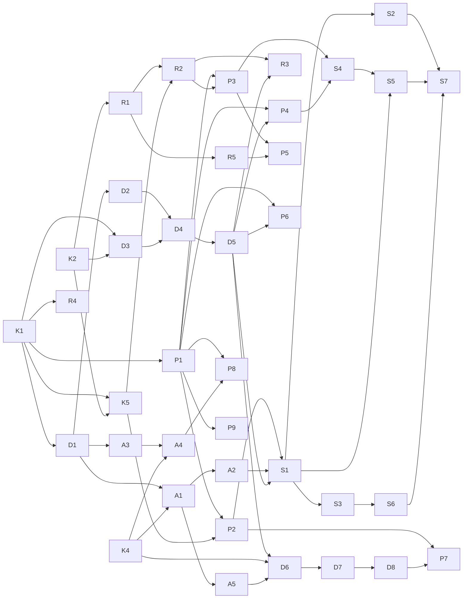

# TASKS.md: Cool Flames task board

Snapshot of the team task board for NASA Space Apps 2026 ("Flame in Freefall"). Project context is in `CLAUDE.md`; the data contract is in `SCHEMA.md`.

Snapshot taken: Sun 15 Nov 2026, 00:45 Europe/Berlin. The live board (Claude Sheets) is the source of truth; if this file and the live board disagree, ask the human.

Last updated by Claude Code: **Sun 15 Nov 2026 (Malay session)** — see Change log.

## Working agreement for Claude Code (READ FIRST, both sessions)

This repo is built by two people, each driving their own Claude Code, committing to `main` and pulling each other's work. To stay coherent across sessions:

1. **At the start of a session:** read `CLAUDE.md`, `SCHEMA.md`, then this file's **Change log** below. The Change log is the authoritative record of where the build has deviated from the original `CLAUDE.md` brief.
2. **Confirm the task ID** with the human and stay inside that owner's folders (CLAUDE.md §5: Malay owns `pipeline/`, `core/`, `data/clean/`, `data/manual/`, README; Ramneek owns `ai/`, `data/ai/`, `app/`, deploy).
3. **When you finish a task:** set its Status to `Done` here, tick its checkbox, update the **Progress** count and the **Ready now** list, and append a dated bullet to the **Change log** describing what changed — *especially any decision that deviates from `CLAUDE.md` or the schema*.
4. **Keep the app working at every commit** (the team may deploy at any moment) and commit in small steps with `area: what changed` messages.
5. If a decision changes the data contract, update `SCHEMA.md` and flag it here; both owners must agree.

> In short: whoever works next should be able to read this file top-to-bottom and know exactly what is done, what changed, and what is ready — without having to re-derive it. Keep it current.

## How to use this file

- Status values: `To do`, `In progress`, `Done`, `Cut`. A task marked `Cut` counts as finished for its dependents.
- A task is **ready** when every task in its *Depends on* list is `Done` or `Cut`.
- When you finish a task: tick its checkbox, set its status to `Done`, then re-check the *Unlocks* list to see what became ready. Move those to the Ready now section.
- Before starting a task, confirm with the human which task ID you are on and stay inside that owner's folders (see `CLAUDE.md` section 5).
- Never mark a task `Done` until its *Done when* condition is actually true (run the check, do not assume).
- Edit this file with small diffs. Keep task IDs stable; never renumber.

## Progress

**8 of 39 done** (K1, K2, K5, D1, D2, D3, D4, D5). Real `data/clean/tests.csv` now exists (527 rows from the 4 core tables).

## Change log (approach changes & decisions — newest first)

### Sun 15 Nov 2026 — Malay session (Claude Code)

**Infra**
- Created a Python venv at `.venv/` and installed `requests` + `pytest` for the pipeline. **`requirements.txt` is not yet version-pinned** — pin it before the first deploy (S1).

**D1 — fetch (Done)**
- The experiment tables are **not** at the record's `remote_url` field (that 404s). The working download route is the GEODE/OSDR studies endpoint, now baked into `fetch_psi.py`:
  `https://psi.nasa.gov/geode-py/ws/studies/{accession}/download?source=datamanager&file={file_name}`
- `fetch_psi.py` now downloads 24 records → `data/raw/*.json` **and** 22 experiment tables → `data/raw/tables/*.csv`. Idempotent (`--force` to refetch). 4 investigations are text-only with no table (PSI-60, PSI-62, PSI-115, PSI-117). ~2,870 test rows total across the 22 tables.

**D2 — inventory (Done)**
- Added `pipeline/inventory.py`, which (re)generates `data/raw/columns.md` (per-table columns + sample values).
- Column quirks to handle downstream: a UTF-8 BOM on the first header of several files, trailing spaces in headers, typos (`Samle Thickness`), units embedded in *values* (`20 cm/s`, `80 W`), and fuzzy/range values (`~ 21.5`, `22.1 to 22.0`).

**K2 — schema (Done)**
- `SCHEMA.md` signed by the human. No column changes from CLAUDE.md §6.

**K5 — fake data (Done)**
- `data/fake/tests.csv` (10 rows) + `data/fake/investigations.json` (3 entries: prevention/suppression/detection). Covers every enum, keeps real blanks (not zero-filled), ppo2 consistent; investigations use obviously-fake placeholder DOIs (`10.0000/demo-*`) so no demo entry is mistaken for a real citation. Unblocks R2 (ranking) and P2 (Overview) — both can be built before real data lands.

**D5 — build_tests.py (Done)**
- `python -m pipeline.build_tests` applies the 4 mappings → `data/clean/tests.csv` (**527 rows**: FLEX 274, BASS-II 129, SAME-R 109, Saffire-II 15). Consumes the `_FORMAT.md` rules (BOM strip, `~`/range→midpoint, unit conversion via `units.py`, `outcome_from`/`diluent_from`). **Run it as a module** (`python -m pipeline.build_tests`), not `python pipeline/build_tests.py`, or the `pipeline` import fails.
- Added `tests/test_schema.py` (validates both fake and clean `tests.csv`: columns, enums, ppo2 consistency, blanks). Full suite: **25 pass**.
- Decision: a non-positive pressure is treated as **not reported (blank)**, not 0 — 0 mmHg is unphysical (one FLEX row had `0`), unlike 0 airflow which is a real condition. Row kept, excluded from gap map, flagged.
- **Gap-map reality:** only **273 of 527 rows have both O2 and pressure** (all FLEX). BASS-II/Saffire/SAME-R carry no pressure (strict policy). The other 7 pressure-bearing tables come via D6. → Ramneek/P4: expect a sparse gap map until D6 lands.

**D4 — core-table mappings (Done) — key decisions**
- **Dropped BASS (PSI-26)** from the core tables: its experiment table is only a run log (fuel + IDs, **no conditions or metrics**). BASS-II (PSI-25) represents the BASS family instead. So the core set is **4 tables (FLEX, BASS-II, Saffire-II, SAME-R), not 5**. (Deviates from CLAUDE.md §7; the other 17 tables still come via D6.)
- **Pressure policy = STRICT, leave blank (affects the gap map).** Only **8 of 22 tables have a pressure column**. The other 14 — including BASS-II, all Saffire, SAME/SAME-R, SPICE, SLICE and the ACME experiments — ran at cabin pressure that was never tabulated. Per CLAUDE.md §11 (no fabrication) we **leave `pressure_psi` blank** rather than assume 14.7 psi. Consequence: those runs are **excluded from the gap map (P4)** but kept in `tests.csv`.
  - **→ Ramneek / P4:** design the gap map to show "N of M runs plotted" and note that pressure-less runs are omitted. Don't expect BASS-II/Saffire/SAME-R to appear on it.
- **Saffire O2** fuzzy values (`~ 21.5`, `22.1 to 22.0`) are parsed as the **range midpoint**, `~` stripped.
- **Mapping file format extended** beyond CLAUDE.md §7: added optional `outcome_from` and `diluent_from` blocks and `unit` hints (`fraction`, `pct`, `cm`, `cms`, pressure units). Documented in **`pipeline/mappings/_FORMAT.md`** — D5 (`build_tests.py`) and D6 must honour it.

**New/changed files this session:** `CLAUDE.md`, `TASKS.md` (now in repo), `pipeline/fetch_psi.py`, `pipeline/inventory.py`, `pipeline/units.py`, `tests/test_units.py` (23 pass), `pipeline/mappings/_FORMAT.md`, `pipeline/mappings/PSI-69_FLEX.json`, `PSI-25_BASS-II.json`, `PSI-99_SAFFIRE-2.json`, `PSI-101_SAME-R.json`, `data/raw/` (records + tables + `columns.md`).

**Notes for Ramneek's workstream (AI + app):**
- The data contract is signed — build the app against `data/fake/` until D5 lands `data/clean/tests.csv`.
- `investigations.json` ranges are computed from `tests.csv` by the pipeline (D8), **not** by the LLM.
- **A3 (Q&A index) is ready now** (depends only on D1) and can be built offline. **A1 is still blocked on K4** (API key).

## Milestones

| Time (Europe/Berlin) | Milestone |
|---|---|
| Sat 22:30 | Schema agreed (K2), fake data pushed (K5) |
| Sun 01:30 | Night check-in, then sleep by 02:00 |
| Sun 09:00 | Morning sync, plan the day |
| Sun 12:30 | Core features freeze, first deploy (S1) |
| Sun 15:30 | Feature freeze; only polish, demo and write-up after this |
| Sun 18:00 | Submission review |
| Sun 19:00 | Target submission (official deadline reportedly 23:59 local; confirm in K3) |

## Critical path

K1 -> D1 -> D2 -> D4 -> D5 -> (P4 gap map, R3 ranking check, S1 deploy) -> S4 demo script -> S5 video -> S7 submit.

**Current position:** K1, D1, D2, D3, D4, D5 done; `data/clean/tests.csv` exists (527 rows, 4 core tables). Next critical-path moves: **R1→R2** (ranking, so P3 unblocks) and **D6** (the other 17 tables, which also enriches the gap map). D6 needs K4 + A5 (Ramneek) first.

Cut order if behind: P9 Earth benefits, then P8 Ask, then P7 Compare.

## Ready now

- **K3** Confirm deadline and team registration (Ramneek, 5 min)
- **K4** Claim Gemini or Azure offer, API key in .env (Ramneek, 10 min)
- **R1** scenarios.py (Malay, 30 min) — *next on critical path (unblocks R2 ranking)*
- **R4** earth_vs_space.csv (Malay, 40 min)
- **A3** Q&A index: chunks, embeddings, FAISS (Ramneek, 45 min) — *can build offline*
- **P1** App skeleton: pages, sidebar habitat picker, disclaimer (Ramneek, 30 min)

## Summary table

| ID | Task | Owner | Status | Depends on | Unlocks | Est (min) | Slot |
|---|---|---|---|---|---|---|---|
| K1 | Create GitHub repo with folder layout, add Ramneek | Malay | Done | - | K5, D1, D3, R4, P1 | 10 | Kickoff |
| K2 | Agree data schema, write SCHEMA.md | Both | Done | - | K5, D3, R1 | 15 | Kickoff |
| K3 | Confirm deadline and team registration | Ramneek | To do | - | - | 5 | Kickoff |
| K4 | Claim Gemini or Azure offer, API key in .env | Ramneek | To do | - | D6, A1, A4 | 10 | Kickoff |
| K5 | Commit fake tests.csv (10 rows) and investigations.json (3) | Malay | Done | K1, K2 | R2, P2 | 10 | Kickoff |
| D1 | Run fetch_psi.py, commit data/raw/ | Malay | Done | K1 | D2, A1, A3 | 15 | Sat night |
| D2 | Inventory column names and units per table | Malay | Done | D1 | D4 | 20 | Sat night |
| D3 | units.py: psi, % O2, ppO2 conversions + tests | Malay | Done | K1, K2 | D4 | 30 | Sat night |
| D4 | Hand-map core tables (FLEX, BASS-II, Saffire-II, SAME-R; BASS dropped) | Malay | Done | D2, D3 | D5 | 90 | Sat night |
| D5 | build_tests.py: merge into data/clean/tests.csv | Malay | Done | D4 | D6, R3, P4, P6, S1 | 30 | Sat night |
| D6 | LLM proposes mappings for other 17 tables, review each | Malay | To do | D5, K4, A5 | D7 | 120 | Sun morning |
| D7 | Spot-check 20 random rows against raw CSVs | Malay | To do | D6 | D8 | 30 | Sun morning |
| D8 | Per-investigation ranges and run counts | Malay | To do | D7 | P7 | 20 | Sun morning |
| R1 | scenarios.py: 4 habitat presets, 6 scenarios with phases | Malay | To do | K2 | R2, R5 | 30 | Sat night |
| R2 | ranking.py: 4 score parts, weights as args | Malay | To do | R1, K5 | R3, P3 | 60 | Sat night |
| R3 | Sanity check: Moon Base + electrical overheat ranks SAME/SAME-R top | Malay | To do | R2, D5 | - | 20 | Sun morning |
| R4 | earth_vs_space.csv: 5 to 10 hand rows with sources | Malay | To do | K1 | - | 40 | Sun morning |
| R5 | Warning card rules (no data yet, hidden hazard, blind spot) | Malay | To do | R1 | P5 | 20 | Sun morning |
| A1 | Prompt + JSON schema for tags and summaries, test on 3 | Ramneek | To do | D1, K4 | A2, A5 | 30 | Sat night |
| A2 | Run on all 24, save investigations.json, read each | Ramneek | To do | A1 | S1 | 45 | Sat night |
| A3 | Q&A index: chunks, embeddings, FAISS | Ramneek | To do | D1 | A4 | 45 | Sun midday |
| A4 | Q&A function with DOI citations + keyword fallback | Ramneek | To do | A3, K4 | P8 | 45 | Sun midday |
| A5 | Help with column-mapping prompt for D6 | Ramneek | To do | A1 | D6 | 20 | Sun morning |
| P1 | App skeleton: pages, sidebar habitat picker, disclaimer | Ramneek | To do | K1 | P2, P3, P4, P6, P8, P9 | 30 | Sat night |
| P2 | Overview page: cards, filters, DOI links | Ramneek | To do | P1, K5 | P7, S1 | 60 | Sat night |
| P3 | Scenario Explorer: pickers, phase tabs, ranked list, sliders | Ramneek | To do | P1, R2 | P5, S4 | 120 | Sun morning |
| P4 | Gap map: O2 vs psi scatter, habitats, ppO2 lines | Ramneek | To do | P1, D5 | S4 | 90 | Sun morning |
| P5 | Warning cards in Scenario Explorer | Ramneek | To do | P3, R5 | - | 30 | Sun midday |
| P6 | CSV download button | Ramneek | To do | P1, D5 | - | 10 | Sun midday |
| P7 | Compare page (stretch) | Malay | To do | P2, D8 | - | 60 | Sun afternoon |
| P8 | Ask page (stretch) | Ramneek | To do | P1, A4 | - | 45 | Sun afternoon |
| P9 | Earth benefits panel (stretch) | Malay | To do | P1 | - | 20 | Sun afternoon |
| S1 | First deploy to Streamlit Community Cloud | Ramneek | To do | P2, A2, D5 | S2, S3, S5 | 20 | Sun 12:30 |
| S2 | Test public link in private window and on phone | Malay | To do | S1 | S7 | 10 | Sun afternoon |
| S3 | README: run steps, data DOIs, AI-use note, disclaimer | Malay | To do | S1 | S6 | 40 | Sun 15:30 |
| S4 | Final demo script | Both | To do | P3, P4 | S5 | 20 | Sun 15:30 |
| S5 | Record demo video | Both | To do | S4, S1 | S7 | 45 | Sun 15:30 |
| S6 | Project summary on form, all DOIs, AI use declared | Ramneek | To do | S3 | S7 | 30 | Sun 18:00 |
| S7 | Final check and submit | Both | To do | S2, S5, S6 | - | 15 | Sun 18:00 |

## Tasks by workstream

### Kickoff

- [x] **K1: Create GitHub repo with folder layout, add Ramneek**
  - Owner: Malay | Status: Done | Estimate: 10 min | Slot: Kickoff
  - Depends on: nothing
  - Unlocks: K5, D1, D3, R4, P1
  - Done when: Both can push to main
- [x] **K2: Agree data schema, write SCHEMA.md**
  - Owner: Both | Status: Done | Estimate: 15 min | Slot: Kickoff
  - Depends on: nothing
  - Unlocks: K5, D3, R1
  - Done when: Both have signed off the columns
  - Result: SCHEMA.md written and signed; mirrors CLAUDE.md §6 (no column changes).
- [ ] **K3: Confirm deadline and team registration**
  - Owner: Ramneek | Status: To do | Estimate: 5 min | Slot: Kickoff
  - Depends on: nothing
  - Unlocks: nothing
  - Done when: Deadline written in the plan doc
- [ ] **K4: Claim Gemini or Azure offer, API key in .env**
  - Owner: Ramneek | Status: To do | Estimate: 10 min | Slot: Kickoff
  - Depends on: nothing
  - Unlocks: D6, A1, A4
  - Done when: Test call returns JSON
- [x] **K5: Commit fake tests.csv (10 rows) and investigations.json (3)**
  - Owner: Malay | Status: Done | Estimate: 10 min | Slot: Kickoff
  - Depends on: K1, K2
  - Unlocks: R2, P2
  - Done when: Files in data/fake/ match schema
  - Result: data/fake/tests.csv (10 rows, all enums + blanks) and data/fake/investigations.json (3 areas) validated against the schema. Placeholder DOIs (10.0000/demo-*).

### Data pipeline (Malay)

- [x] **D1: Run fetch_psi.py, commit data/raw/**
  - Owner: Malay | Status: Done | Estimate: 15 min | Slot: Sat night
  - Depends on: K1
  - Unlocks: D2, A1, A3
  - Done when: 24 records and 22 tables in repo
  - Result: 24 records + 22 tables in data/raw/ (+ tables/). Tables fetched via GEODE studies endpoint, not remote_url — see Change log.
- [x] **D2: Inventory column names and units per table**
  - Owner: Malay | Status: Done | Estimate: 20 min | Slot: Sat night
  - Depends on: D1
  - Unlocks: D4
  - Done when: data/raw/columns.md written
  - Result: data/raw/columns.md generated by pipeline/inventory.py.
- [x] **D3: units.py: psi, % O2, ppO2 conversions + tests**
  - Owner: Malay | Status: Done | Estimate: 30 min | Slot: Sat night
  - Depends on: K1, K2
  - Unlocks: D4
  - Done when: 5 known values pass
  - Result: pipeline/units.py + tests/test_units.py — 23 cases pass (all unit types, real FLEX mmHg, 4 habitat ppO2 anchors).
- [x] **D4: Hand-map core tables (FLEX, BASS-II, Saffire-II, SAME-R)**
  - Owner: Malay | Status: Done | Estimate: 90 min | Slot: Sat night
  - Depends on: D2, D3
  - Unlocks: D5
  - Done when: Mappings saved in pipeline/mappings/
  - Result: 4 mappings in pipeline/mappings/ (+ _FORMAT.md). BASS (PSI-26) dropped as it has no condition/metric columns; pressure left blank globally. See Change log for all decisions.
- [x] **D5: build_tests.py: merge into data/clean/tests.csv**
  - Owner: Malay | Status: Done | Estimate: 30 min | Slot: Sat night
  - Depends on: D4
  - Unlocks: D6, R3, P4, P6, S1
  - Done when: tests.csv loads with all schema columns
  - Result: 527 rows from 4 core tables; tests/test_schema.py added (25 pass total). Run via `python -m pipeline.build_tests`. See Change log for the non-positive-pressure decision and gap-map sparsity note.
- [ ] **D6: LLM proposes mappings for other 17 tables, review each**
  - Owner: Malay | Status: To do | Estimate: 120 min | Slot: Sun morning
  - Depends on: D5, K4, A5
  - Unlocks: D7
  - Done when: Every table has mapping_confidence set
- [ ] **D7: Spot-check 20 random rows against raw CSVs**
  - Owner: Malay | Status: To do | Estimate: 30 min | Slot: Sun morning
  - Depends on: D6
  - Unlocks: D8
  - Done when: Errors fixed or noted
- [ ] **D8: Per-investigation ranges and run counts**
  - Owner: Malay | Status: To do | Estimate: 20 min | Slot: Sun morning
  - Depends on: D7
  - Unlocks: P7
  - Done when: data/clean/ranges.csv written

### Ranking and scenarios (Malay)

- [ ] **R1: scenarios.py: 4 habitat presets, 6 scenarios with phases**
  - Owner: Malay | Status: To do | Estimate: 30 min | Slot: Sat night
  - Depends on: K2
  - Unlocks: R2, R5
  - Done when: Presets importable by the app
- [ ] **R2: ranking.py: 4 score parts, weights as args**
  - Owner: Malay | Status: To do | Estimate: 60 min | Slot: Sat night
  - Depends on: R1, K5
  - Unlocks: R3, P3
  - Done when: Returns ranked list on fake data
- [ ] **R3: Sanity check: Moon Base + electrical overheat ranks SAME/SAME-R top**
  - Owner: Malay | Status: To do | Estimate: 20 min | Slot: Sun morning
  - Depends on: R2, D5
  - Unlocks: nothing
  - Done when: Ranking looks right on real data
- [ ] **R4: earth_vs_space.csv: 5 to 10 hand rows with sources**
  - Owner: Malay | Status: To do | Estimate: 40 min | Slot: Sun morning
  - Depends on: K1
  - Unlocks: nothing
  - Done when: Each row cites a paper
- [ ] **R5: Warning card rules (no data yet, hidden hazard, blind spot)**
  - Owner: Malay | Status: To do | Estimate: 20 min | Slot: Sun morning
  - Depends on: R1
  - Unlocks: P5
  - Done when: Function returns cards per scenario

### AI layer (Ramneek)

- [ ] **A1: Prompt + JSON schema for tags and summaries, test on 3**
  - Owner: Ramneek | Status: To do | Estimate: 30 min | Slot: Sat night
  - Depends on: D1, K4
  - Unlocks: A2, A5
  - Done when: 3 outputs look right
- [ ] **A2: Run on all 24, save investigations.json, read each**
  - Owner: Ramneek | Status: To do | Estimate: 45 min | Slot: Sat night
  - Depends on: A1
  - Unlocks: S1
  - Done when: data/ai/investigations.json committed
- [ ] **A3: Q&A index: chunks, embeddings, FAISS**
  - Owner: Ramneek | Status: To do | Estimate: 45 min | Slot: Sun midday
  - Depends on: D1
  - Unlocks: A4
  - Done when: Index saved in data/ai/index/
- [ ] **A4: Q&A function with DOI citations + keyword fallback**
  - Owner: Ramneek | Status: To do | Estimate: 45 min | Slot: Sun midday
  - Depends on: A3, K4
  - Unlocks: P8
  - Done when: Answers cite DOIs; works offline
- [ ] **A5: Help with column-mapping prompt for D6**
  - Owner: Ramneek | Status: To do | Estimate: 20 min | Slot: Sun morning
  - Depends on: A1
  - Unlocks: D6
  - Done when: Prompt returns structured JSON
  - Note: the mapping format D6 expects is documented in `pipeline/mappings/_FORMAT.md` (includes `outcome_from`/`diluent_from`/`unit` hints). Target that format.

### Streamlit app (mostly Ramneek)

- [ ] **P1: App skeleton: pages, sidebar habitat picker, disclaimer**
  - Owner: Ramneek | Status: To do | Estimate: 30 min | Slot: Sat night
  - Depends on: K1
  - Unlocks: P2, P3, P4, P6, P8, P9
  - Done when: streamlit run shows all pages
  - Note: skeleton pages already stubbed in `app/` (Home.py + pages/1..6). Flesh out P1 from there.
- [ ] **P2: Overview page: cards, filters, DOI links**
  - Owner: Ramneek | Status: To do | Estimate: 60 min | Slot: Sat night
  - Depends on: P1, K5
  - Unlocks: P7, S1
  - Done when: Cards render from investigations.json
- [ ] **P3: Scenario Explorer: pickers, phase tabs, ranked list, sliders**
  - Owner: Ramneek | Status: To do | Estimate: 120 min | Slot: Sun morning
  - Depends on: P1, R2
  - Unlocks: P5, S4
  - Done when: Sliders change ranking live
- [ ] **P4: Gap map: O2 vs psi scatter, habitats, ppO2 lines**
  - Owner: Ramneek | Status: To do | Estimate: 90 min | Slot: Sun morning
  - Depends on: P1, D5
  - Unlocks: S4
  - Done when: Every test run with O2 AND pressure plotted
  - Note: pressure is sparse — only 8 of 22 tables measure it (see Change log). Show "N of M runs plotted" and note that pressure-less runs (BASS-II, Saffire, SAME-R, etc.) are omitted.
- [ ] **P5: Warning cards in Scenario Explorer**
  - Owner: Ramneek | Status: To do | Estimate: 30 min | Slot: Sun midday
  - Depends on: P3, R5
  - Unlocks: nothing
  - Done when: Cards show for Moon and liquid fuels
- [ ] **P6: CSV download button**
  - Owner: Ramneek | Status: To do | Estimate: 10 min | Slot: Sun midday
  - Depends on: P1, D5
  - Unlocks: nothing
  - Done when: Downloaded CSV opens
- [ ] **P7: Compare page (stretch)**
  - Owner: Malay | Status: To do | Estimate: 60 min | Slot: Sun afternoon
  - Depends on: P2, D8
  - Unlocks: nothing
  - Done when: 2 to 4 investigations side by side
- [ ] **P8: Ask page (stretch)**
  - Owner: Ramneek | Status: To do | Estimate: 45 min | Slot: Sun afternoon
  - Depends on: P1, A4
  - Unlocks: nothing
  - Done when: Chat answers with DOI links
- [ ] **P9: Earth benefits panel (stretch)**
  - Owner: Malay | Status: To do | Estimate: 20 min | Slot: Sun afternoon
  - Depends on: P1
  - Unlocks: nothing
  - Done when: 3 items shown

### Ship (both)

- [ ] **S1: First deploy to Streamlit Community Cloud**
  - Owner: Ramneek | Status: To do | Estimate: 20 min | Slot: Sun 12:30
  - Depends on: P2, A2, D5
  - Unlocks: S2, S3, S5
  - Done when: Public link loads
  - Note: pin `requirements.txt` versions before deploying (currently unpinned).
- [ ] **S2: Test public link in private window and on phone**
  - Owner: Malay | Status: To do | Estimate: 10 min | Slot: Sun afternoon
  - Depends on: S1
  - Unlocks: S7
  - Done when: No errors on either
- [ ] **S3: README: run steps, data DOIs, AI-use note, disclaimer**
  - Owner: Malay | Status: To do | Estimate: 40 min | Slot: Sun 15:30
  - Depends on: S1
  - Unlocks: S6
  - Done when: README complete
  - Note: must disclose the strict pressure policy (pressure-less runs omitted from the gap map).
- [ ] **S4: Final demo script**
  - Owner: Both | Status: To do | Estimate: 20 min | Slot: Sun 15:30
  - Depends on: P3, P4
  - Unlocks: S5
  - Done when: Script timed under 2 min
- [ ] **S5: Record demo video**
  - Owner: Both | Status: To do | Estimate: 45 min | Slot: Sun 15:30
  - Depends on: S4, S1
  - Unlocks: S7
  - Done when: Video uploaded
- [ ] **S6: Project summary on form, all DOIs, AI use declared**
  - Owner: Ramneek | Status: To do | Estimate: 30 min | Slot: Sun 18:00
  - Depends on: S3
  - Unlocks: S7
  - Done when: Form filled, not yet submitted
- [ ] **S7: Final check and submit**
  - Owner: Both | Status: To do | Estimate: 15 min | Slot: Sun 18:00
  - Depends on: S2, S5, S6
  - Unlocks: nothing
  - Done when: Submission confirmed

## By owner

### Malay

K1 (done), K2 (done), K5 (done), D1 (done), D2 (done), D3 (done), D4 (done), D5 (done), D6, D7, D8, R1, R2, R3, R4, R5, P7, P9, S2, S3

### Ramneek

K3, K4, A1, A2, A3, A4, A5, P1, P2, P3, P4, P5, P6, P8, S1, S6

### Both

K2 (done), S4, S5, S7

## Dependency graph (Mermaid)

